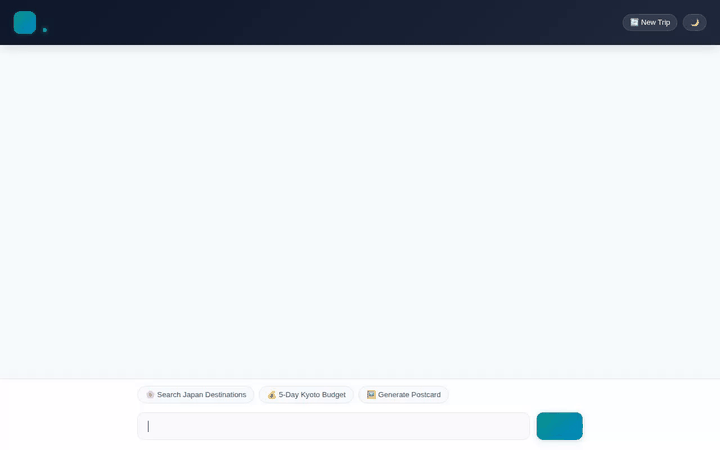

# ✈️ Voyager — Travel & Itinerary Concierge Agent



**Voyager** is a conversational AI travel concierge built with the **Google Agent Development Kit (ADK)**. It helps travelers discover curated destinations, calculate itemized trip budgets, check real-time weather conditions, geocode landmarks, locate nearby attractions, and generate visual AI travel postcards and video previews.

---

## 🚀 Key Features & Capabilities

- **🧠 Memory & Context Persistence**: Uses `VertexAiMemoryBankService` to store and recall traveler preferences, food allergies, dietary restrictions, and bucket-list items across conversations.
- **🗄️ Firestore Destination Search**: Queries a curated Firestore document collection (`destinations`) for travel categories, daily costs, and top attraction highlights.
- **💰 Itemized Budget Calculator**: Computes customized lodging, dining, activity, and contingency buffer estimates based on traveler count and trip duration.
- **🌤️ Real-Time Weather Integration**: Fetches live current temperatures, wind speeds, and daily forecasts via the Open-Meteo API.
- **🗺️ Geocoding & Nearby Attractions**: Converts street addresses and landmarks into geographic coordinates (Google Maps Geocoding API) and discovers nearby points of interest (Google Places API).
- **🖼️ AI Postcard Generation**: Generates visual travel postcards on demand using Google's `gemini-3.1-flash-lite-image` model in the global region.
- **🎬 Short Travel Video Generation**: Generates 3-second destination video previews using Google's `gemini-omni-flash-preview` model via the Interactions API in the global region, storing outputs in Playground Artifacts and Cloud Storage.
- **☁️ Cloud Storage Artifact Sync**: Uploads generated images and videos directly to a public Google Cloud Storage bucket and returns public HTTPS links.
- **🧮 Secure Code Execution**: Runs dynamic budget calculations and schedule pacing in a secure Vertex AI Agent Engine sandbox (`execute_code`).
- **🎨 Structured A2UI Interfaces**: Renders compact, interactive UI components (Cards, Columns, Rows, Text, Images, and Lightbox modals) using A2UI Basic Catalog v0.8.

---

## 🛠️ Implemented Agent Tools

| Tool Name | Service / Engine | Description |
| :--- | :--- | :--- |
| `search_destinations` | Google Cloud Firestore | Searches curated travel destinations by keyword, category, or region. |
| `add_destination` | Google Cloud Firestore | Adds new travel destination entries directly into Firestore. |
| `calculate_itinerary_budget` | Agent Logic + Firestore | Calculates lodging, dining, activity, and buffer costs for trips. |
| `get_live_weather` | Open-Meteo API | Returns current live weather conditions and daily high/low temperatures. |
| `geocode_address` | Google Maps Geocoding API | Converts place names and street addresses into latitude/longitude coordinates. |
| `find_nearby_places` | Google Places API (New) | Searches nearby attractions, restaurants, parks, and museums. |
| `generate_destination_image` | Gemini 3.1 Flash Lite Image | Generates travel postcard images and stores them in Cloud Storage & Artifacts. |
| `generate_destination_video` | Gemini Omni Flash Preview | Generates short destination preview videos via the Interactions API. |
| `PreloadMemoryTool` | Vertex AI Memory Bank | Preloads relevant user memories into the conversation turn. |
| `execute_code` | Agent Engine Sandbox | Executes Python code in a sandboxed environment for complex math. |

---

## 🏛️ Google Cloud Architecture

- **Agent Framework**: Google ADK (`google-adk`)
- **Agent Runtime**: Vertex AI Agent Engine / Reasoning Engine (`us-east1`)
- **Memory Service**: Vertex AI Memory Bank (`VertexAiMemoryBankService`)
- **Database**: Cloud Firestore (`qwiklabs-gcp-01-8abcae82c3b6`)
- **Asset Storage**: Google Cloud Storage (`voyager-agent-assets-qwiklabs-gcp-01-8abcae82c3b6`)
- **Frontend**: FastAPI Async Proxy with A2A Protocol client & HTML5/CSS3 interface

---

## 📋 Planned / Future Features

- ⏳ **Google Maps Route & Pacing Optimization**: Multi-stop turn-by-turn itinerary routing (*planned, not yet implemented*).

---

## 💻 Local Setup & Development

### Prerequisites
- Python 3.11+
- Node.js & `uv` package manager
- Google Cloud SDK (`gcloud`) authenticated to GCP project

### 1. Environment Setup
Clone the repository and install Python dependencies:
```bash
uv venv .venv
source .venv/bin/activate
uv pip install -r requirements.txt
```

Set environment variables in `.env`:
```bash
GOOGLE_CLOUD_PROJECT="<your-gcp-project-id>"
GOOGLE_CLOUD_LOCATION="us-east1"
GOOGLE_GENAI_USE_VERTEXAI="true"
GOOGLE_MAPS_API_KEY="<your-google-maps-api-key>"
```

### 2. Running Frontend Locally
To start the local FastAPI web server and UI on port 8080:
```bash
cd frontend
uv run uvicorn main:app --port 8080 --host 0.0.0.0
```

Open a web browser and navigate to port `8080` on `localhost`.

### 3. Deploying Agent Runtime
To deploy the agent to Vertex AI Agent Runtime:
```bash
agents-cli deploy --no-confirm-project --service-name simple-agent
```
